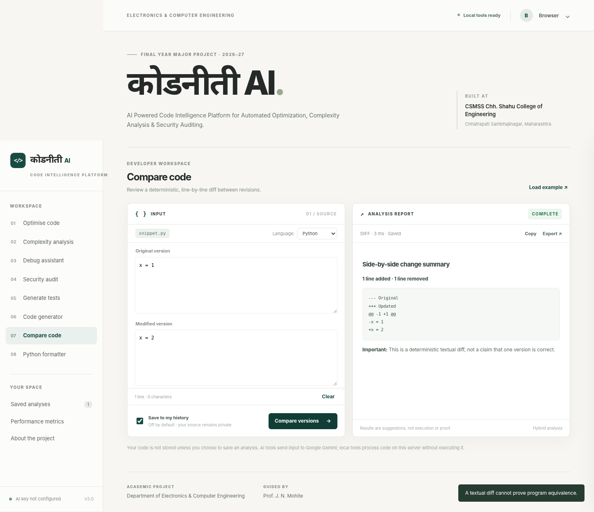

# कोडनीती AI

**AI Powered Code Intelligence Platform for Automated Optimization, Complexity Analysis & Security Auditing**

Final Year Major Project (2026–27) · Department of **Electronics & Computer Engineering**  
**CSMSS Chh. Shahu College of Engineering, Chhatrapati Sambhajinagar, Maharashtra**

| Project team | College identifier | Enrollment number |
|---|---|---|
| DHUPPE HARSHAD MADHAV | EC4145 | 23025331844046 |
| SHINDE SAURABH BHAGAJI | EC4121 | 23025331844021 |
| KALE PRADEEP DYANESHWAR | EC4168 | 24025331844502 |

**Project guide:** Prof. J. N. Mohite



## Overview

कोडनीती AI is a responsive web workbench for code review and AI-assisted development. It deliberately combines five **AI-assisted** tasks with three **deterministic local** tools. Developers can sign up, sign in, view their own history, review timings and cache usage, and export reports. The interface is written in ordinary HTML, CSS, and JavaScript—no React build step or visual dashboard framework.

This project is a portfolio and academic prototype, **not a guaranteed route to any salary or employer**. The team should be able to explain the source code, tests, limitations and measurements independently.

### Eight tools

| Tool | Method | Uses Gemini? |
|---|---|---|
| Code optimisation | Reasoning, revision and trade-offs | Yes |
| Complexity analysis | Big-O *estimates*, not formal proof | Yes |
| Debug assistant | Bug hypotheses, corrections and regression tests | Yes |
| Test generation | Suggested test cases; tests are not run | Yes |
| Code generator | Requirement-to-code assistance | Yes |
| Compare code | Python `difflib.unified_diff` | No |
| Python formatter | Ruff CLI (no source execution) | No |
| Python security audit | Bandit static checks (not a full audit) | No |

## Run locally

Use **Python 3.11+** (verified here on Python 3.13). From the extracted project directory:

```bash
python -m venv .venv
# Windows PowerShell: .venv\Scripts\Activate.ps1
# macOS/Linux: source .venv/bin/activate
python -m pip install -r requirements.txt
```

Copy `.env.example` to `.env`. Set `GEMINI_API_KEY` to a personal API key from Google AI Studio to enable the five AI tools. **Never commit this key.** The three offline tools can be used with no key.

```bash
python main.py
```

Open **http://127.0.0.1:8000**. Create an account with a unique password (at least 10 characters). API documentation is at `/docs` and service health is at `/health`.

### Deployment on Railway

The app includes a `Dockerfile`, `railway.json`, a `/health` route, and startup configuration that respects Railway's `PORT`. **The team will deploy it; no live public URL or Gemini verification is claimed here.** Follow **[docs/RAILWAY_DEPLOYMENT.md](docs/RAILWAY_DEPLOYMENT.md)** before publishing it. In particular, **add a persistent volume**, set `APP_ENV=production`, and follow Railway's current volume ownership requirements. Without a persistent volume, accounts and saved reports can disappear on redeploy.

## Application design

```text
User browser (Marathi-branded responsive HTML/CSS/JS)
    |
    | Session cookie, same-origin JSON requests
    v
FastAPI HTTP middleware: session resolution, CSRF guard, rate limits
    |
    +--> /api/auth/* : PBKDF2 password hashes, revocable session tokens
    |
    +--> /api/{tool} : Pydantic validation
    |       |
    |       +--> Gemini (async SDK) [five AI tools]
    |       +--> difflib/Ruff/Bandit [three local tools]
    |       |
    |       +--> SHA-256 request fingerprint
    |               --> bounded memory cache --> SQLite cache
    |
    +--> /api/history, /api/stats : account-scoped SQLite queries
    v
SQLite: users, sessions, history, response_cache, ai_quota, metrics
```

- **Authentication and authorization:** Server-side PBKDF2-HMAC password hashes, opaque HttpOnly session cookies, revocable sessions, and SQL queries scoped to the authenticated user. Sign out and delete-account actions are supported.
- **Privacy:** Saving report content is opt-in, default OFF. Saved snippets and outputs are **plaintext in SQLite** (not encrypted at rest). Unsaved submissions are not stored in history or result cache, but the app records performance metadata. AI prompts are transmitted to Google Gemini when you choose an AI tool. Never submit credentials, private company code, or highly sensitive data.
- **Rate controls:** Account-scoped sliding window for signed-in actions, stricter IP-based registration/login attempts, and a configurable **daily AI miss quota**. Cached AI results do not consume a new AI request quota slot. Request throttling is local to one process; scale-out needs a shared limiter.
- **Cache and performance:** TTL/LRU memory + SQLite persistence; SHA-256 fingerprints cover account, tool, validated request, engine, configured model and prompt version. Cache is used only for opted-in saves. Dashboard metrics include cache-hit rate, mean response time and p95 for a bounded sample.
- **Error handling:** Typed input validation, structured provider timeouts/errors, helpful 422/429/502/503/504 statuses, input size caps and safe text-only rendering. The app never executes user-submitted snippets.
- **UI:** Marathi Devanagari branding, intentional neutral color palette, mobile navigation, side-by-side source/report layout, export/copy actions, private history and a dedicated major-project/team panel.

**Real limitations:** No email verification or password reset; limited to a single worker with a local SQLite database; no distributed token accounting; no source-code execution or correctness proof; Bandit covers only a subset of Python vulnerabilities. Do not treat the demo as a security-certified SaaS.

## Tests and performance

```bash
python -m pip install -r requirements-dev.txt
python -m pytest -q
python -m compileall -q main.py routers services models middleware
node --check static/js/app.js       # If Node.js is available
python scripts/benchmark.py          # local, deterministic compare/cache test
python -m playwright install chromium  # one-time browser install
python scripts/e2e_browser.py        # browser interactions via a TestClient bridge
python scripts/smoke.py              # with server running: true HTTP smoke test
```

**Verification during this build:** 17 tests passed, 2 optional real Ruff/Bandit integration tests skipped because those executables were not available in the sandbox. Unit tests for the adapters passed using mocked processes. Browser interaction was tested via Playwright with intercepted API requests passed into a local FastAPI test client; this does **not** replace a real HTTP, live-site E2E test. Actual Gemini calls and Railway hosting have not been tested without your key and deployment account. `scripts/smoke.py` can exercise genuine HTTP requests to a local or deployed server with a disposable account (signup must be enabled).

See **[docs/BENCHMARK_RESULTS.md](docs/BENCHMARK_RESULTS.md)** for the *measured local diff benchmark* and its limitations. **Do not present local cache measurements as real Gemini or Railway performance.**

## Documentation

- **[Railway deployment checklist](docs/RAILWAY_DEPLOYMENT.md)** — exact cloud setup, environment variables, volume, HTTPS cookies and post-deploy verification.
- **[Technical ownership guide](docs/TECHNICAL_OWNERSHIP.md)** — execution trace, sample SQL, authentication/caching explanations, interview questions and exercises the team should complete themselves.
- **[Major project report outline](docs/PROJECT_REPORT_OUTLINE.md)** — problem, scope, methodology, diagrams, evaluation, future work and demo checklist.
- **[Benchmark methodology and results](docs/BENCHMARK_RESULTS.md)** — measured local response and cache timings.
- **[Rebuild and test audit](docs/REBUILD_AUDIT.md)** — bugs fixed, test coverage and verification limitations.
- **[Interview guide](docs/INTERVIEW_GUIDE.md)** — practice questions and talking points.

## Safety and intellectual ownership

Do not upload `.env`, user databases, credentials, or proprietary code to GitHub. The original supplied archive contained secrets and old application artifacts, which are not included in this deliverable. The prior MIT license is retained as `LICENSE`; review any inherited-code obligations before redistribution. AI assistance was used in the rebuild: the student team should review, modify, test and credit work accurately, not claim independent authorship of code they have not understood.
